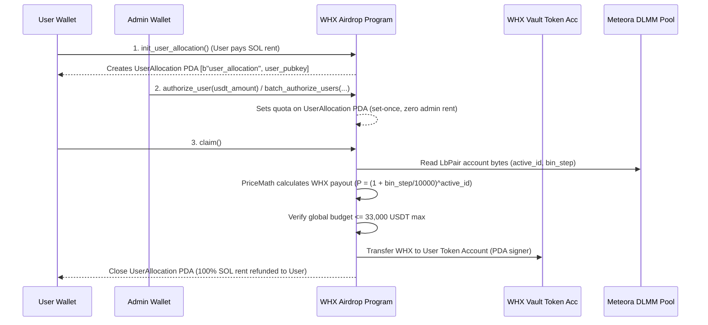

# Repository Guidelines

## Project Overview
**whx-airdrop** is a Solana smart contract platform built with the Anchor Framework (Rust `anchor-lang` 1.1.2 / TS `@coral-xyz/anchor` 0.30.1). It facilitates a USDT-denominated WHX token airdrop where user allocations are authorized in USDT quota units and dynamically calculated into WHX token payouts at claim time using real-time price feeds from an external Meteora DLMM (`LbPair`) liquidity pool oracle. The contract enforces a hard cap of 33,000 USDT total cumulative authorized airdrop budget.

## Architecture & Data Flow



1. **User-Funded Account Model**: Users initialize their own `UserAllocation` PDA (`[b"user_allocation", user_pubkey]`) via `init_user_allocation`, paying the SOL rent upfront (~0.00146 SOL).
2. **Zero-Rent Admin Authorization**: Admins set user quotas via `authorize_user` or `batch_authorize_users` (up to 10 users per transaction using `remaining_accounts`). Quotas are set-once, non-zero, and irrevocable.
3. **Meteora Oracle Price Engine**: During `claim()`, `PriceMath` deserializes raw bin parameters from the Meteora DLMM pool account (`active_id` at offset 112, `bin_step` at offset 128) to compute dynamic exchange rates scaled to $10^9$ precision.
4. **CPI Transfer & PDA Closure**: Tokens are transferred from the `GlobalConfig` vault PDA (`[b"global_config"]`) to the user's token account via SPL Token CPI. The `UserAllocation` PDA is closed (`close = user`), refunding 100% of the rent to the user and preventing re-claiming.

## Key Directories

- `programs/whx-airdrop/src/`: Solana Anchor Rust smart contract source code.
  - `instructions/`: Modular Anchor instruction handlers (`initialize.rs`, `allocation.rs`, `claim.rs`, `update_config.rs`, `withdraw_vault.rs`).
- `scripts/`: TypeScript administrative, operational, deployment, and simulation scripts.
- `tests/`: TS Mocha/Chai integration test suite (`whx_airdrop.ts`) and account fixtures (`fixtures/mock_lb_pair.json`).

## Development Commands

- **Build Contract**: `anchor build` (or `cargo build-sbf`)
- **Run Integration Tests**: `npm test` or `anchor test` (executes `ts-mocha -p ./tsconfig.json -t 1000000 tests/**/*.ts`)
- **Run Rust Unit Tests**: `cargo test`
- **Execute Operational Scripts**: `npx ts-node scripts/<script_name>.ts` (e.g., `npx ts-node scripts/batch_authorize_users.ts`)

## Code Conventions & Common Patterns

### Rust & Anchor Patterns
- **Naming**: `snake_case` for module/function names (`price_math.rs`, `batch_authorize_users`), `PascalCase` for account structs and instruction contexts (`GlobalConfig`, `UserAllocation`, `AuthorizeUsers`).
- **Error Handling**: Custom `ErrorCode` enum in `programs/whx-airdrop/src/error.rs` (e.g., `AlreadyClaimed`, `ExceedsTotalAirdropLimit`, `QuotaAlreadySet`, `ZeroQuota`, `MathOverflow`). Checked arithmetic (`checked_add`, `checked_mul`, `checked_div`) is mandatory for all token calculations.
- **Account Validation**: Declarative Anchor macros with strict seed constraints:
  ```rust
  #[account(
      init,
      payer = user,
      space = 8 + UserAllocation::INIT_SPACE,
      seeds = [USER_ALLOCATION_SEED, user.key().as_ref()],
      bump
  )]
  pub user_allocation: Account<'info, UserAllocation>,
  ```
- **Remaining Accounts & Manual Serialization**: Used in `batch_authorize_users` to dynamically iterate through up to 10 user allocation PDAs, verifying PDA derivation and owner checks before mutating data via `UserAllocation::try_deserialize` and `try_serialize`.
- **CPI Invocation**: Token transfers use `CpiContext::new_with_signer` with global config bump seeds:
  ```rust
  let seeds = &[GLOBAL_CONFIG_SEED, &[ctx.accounts.global_config.bump]];
  let signer = &[&seeds[..]];
  token::transfer(CpiContext::new_with_signer(..., signer), amount)?;
  ```

### TypeScript & Scripting Patterns
- Modern `async/await` utilizing `@coral-xyz/anchor`, `@solana/web3.js` (v1), and `@solana/spl-token`.
- Standardized RPC call execution with pre-flight account existence checks and retry loops (`retryAction`).

## Important Files

- `programs/whx-airdrop/src/lib.rs`: Program entrypoint and instruction routing (`3jkwSf6RG912UinxyAMXyMLomWYGkgAiP9iVGiM6ruEJ`).
- `programs/whx-airdrop/src/state.rs`: On-chain account definitions (`GlobalConfig`, `UserAllocation`) and domain methods.
- `programs/whx-airdrop/src/price_math.rs`: Core oracle math engine for parsing Meteora DLMM byte layouts and computing exponential price formulas.
- `programs/whx-airdrop/src/instructions/claim.rs`: Claim instruction handler executing price conversions, total cap safety checks, and CPI transfers.
- `programs/whx-airdrop/src/instructions/allocation.rs`: Handlers for `init_user_allocation`, `authorize_user`, and `batch_authorize_users`.
- `Anchor.toml`: Program IDs across networks (`localnet`, `devnet`, `mainnet`), test validator fixtures, and provider wallet path (`~/.config/solana/id.json`).
- `Cargo.toml`: Rust workspace setup with release optimizations (`opt-level = "z"`, `lto = "fat"`, `overflow-checks = true`).
- `CONTEXT.md`: In-depth domain glossary and functional specification.

## Runtime/Tooling Preferences

- **Node.js**: Node ^20.x (defined in `@types/node`).
- **Package Manager**: `npm` (manifested via `package-lock.json`).
- **Rust Toolchain**: `1.89.0` (specified in `rust-toolchain.toml` and workspace `Cargo.toml`). Includes `rustfmt` and `clippy`.
- **Anchor Framework**: Anchor JS `@coral-xyz/anchor` `^0.30.1`, Anchor Rust `anchor-lang = "1.1.2"`.
- **TypeScript Settings**: Configured for `ES2020` target with `commonjs` module resolution (`tsconfig.json`).

## Testing & QA

- **Frameworks**: `ts-mocha` + `chai` (`expect` assertions) for integration tests; native `#[cfg(test)]` for Rust unit tests.
- **Local Validator Account Fixtures**: `Anchor.toml` pre-loads Meteora DLMM mainnet pool account `6nDd6Y4SEpURbzArtg3GffL2Ltw16FD2SMKfyUnX7SXf` from `tests/fixtures/mock_lb_pair.json` into localnet runs.
- **Test Scenarios**: High assertion coverage in `tests/whx_airdrop.ts` covering 23 steps: end-to-end user lifecycle, zero/negative boundary conditions, batch user limit validation, price math accuracy, authorization immutability, and 33,000 USDT cap enforcement.
